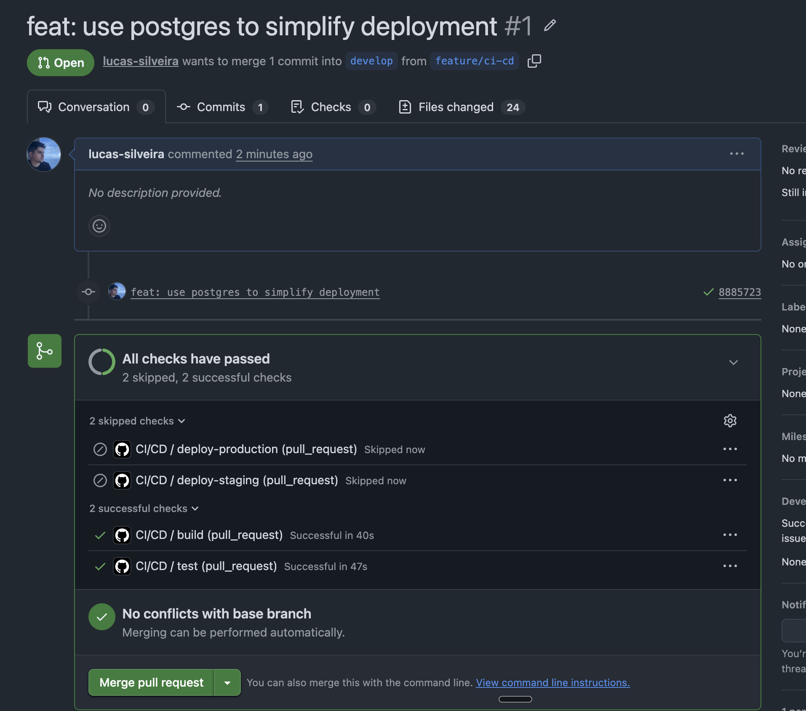
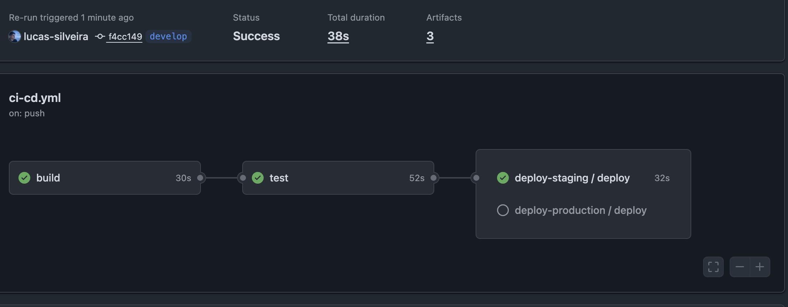
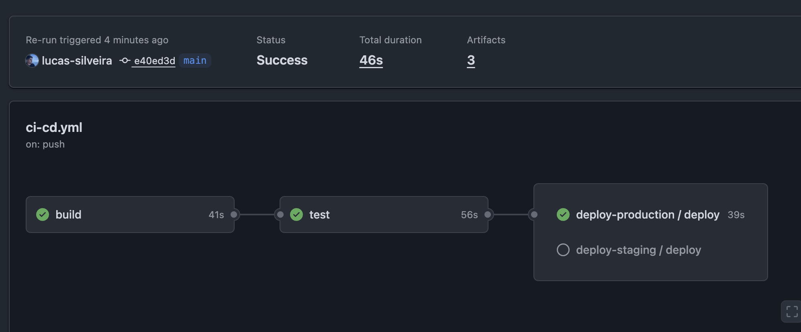
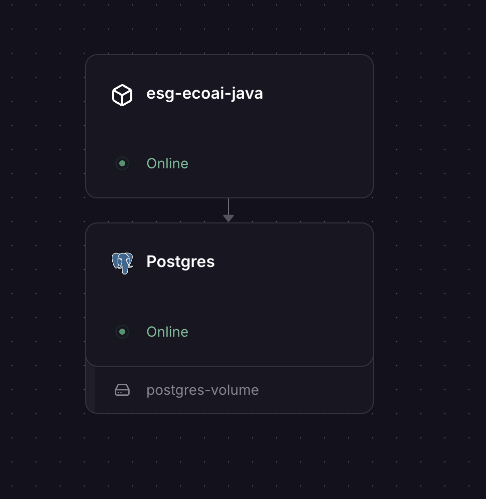
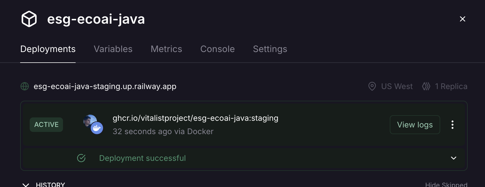
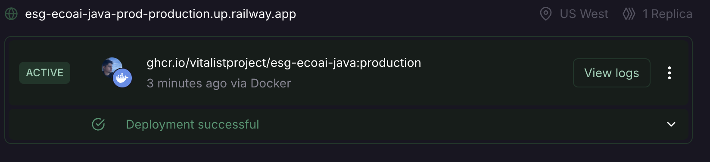
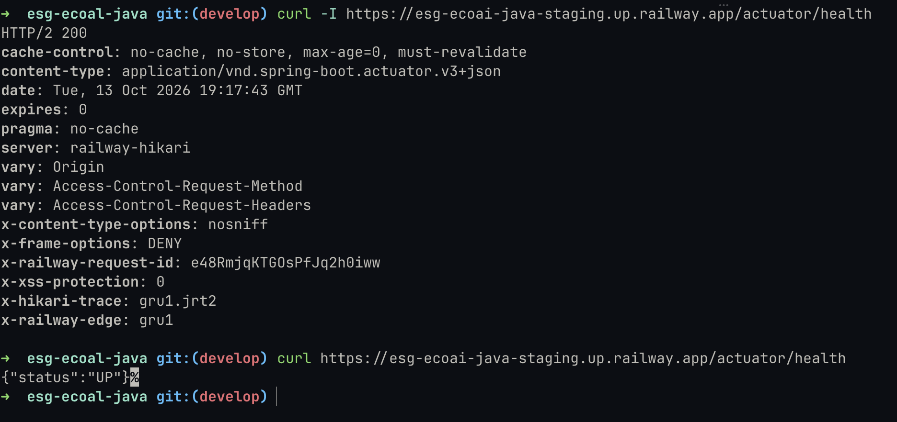
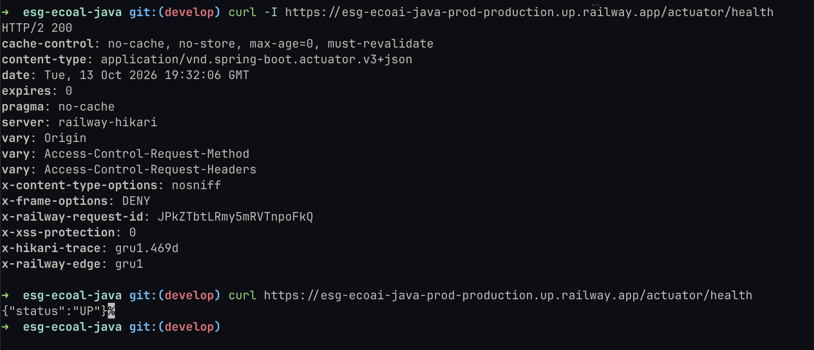

# Projeto - Cidades ESG Inteligentes

**ESG EcoAl API**: API REST para o aplicativo Android EcoAL, que permite às empresas acompanharem metas ESG, tarefas e métricas de desempenho.

## Como executar localmente com Docker

**Pré-requisito:** Docker com Docker Compose.

1. Crie o arquivo `.env` a partir do modelo e preencha os valores:

   ```bash
   cp .env.example .env
   ```

   | Variável | Padrão | Descrição |
   |---|---|---|
   | DB_URL | jdbc:postgresql://localhost:5432/ecoal | URL JDBC do PostgreSQL (no Compose, o perfil `docker` aponta para o serviço `db`) |
   | DB_USER | ecoal | Usuário do banco de dados |
   | DB_PASSWORD | (obrigatória) | Senha do banco de dados |
   | JWT_SECRET | (obrigatória) | Chave de assinatura JWT (mínimo de 32 caracteres / 256 bits para HS256) |
   | SPRING_PROFILES_ACTIVE | (nenhum) | Definido como `docker` automaticamente pelo `docker-compose.yml` |

   `DB_PASSWORD` e `JWT_SECRET` não têm valor padrão. Sem `JWT_SECRET` (ou com menos de 32 caracteres) a aplicação aborta a subida com uma mensagem explícita. Para gerar uma chave: `openssl rand -base64 48`.

2. Suba a aplicação e o banco:

   ```bash
   docker compose up --build
   ```

   O Compose sobe o PostgreSQL 16 (`ecoal-db`), espera o healthcheck do banco e só então inicia a API (`ecoal-api`). As migrations do Flyway e o seed rodam automaticamente na primeira execução.

3. Acesse:

   - API: http://localhost:8080
   - Swagger UI: http://localhost:8080/swagger-ui.html
   - Health check: http://localhost:8080/actuator/health (público; retorna `{"status":"UP"}` quando a aplicação e o banco estão acessíveis, e `503` caso contrário)

4. Para encerrar (mantendo os dados) ou apagar também o volume do banco:

   ```bash
   docker compose down
   docker compose down -v
   ```

**Credenciais do seed padrão:**

| E-mail | Senha | Perfil |
|---|---|---|
| alice@example.com | password | admin |
| bob@example.com | password | user |

### Execução sem Docker para a API (opcional)

**Pré-requisitos:** Java 21, Maven 3.9+ e um PostgreSQL 16 acessível. Para subir só o banco via Docker:

```bash
docker run -d --name postgres-local \
  -e POSTGRES_DB=ecoal \
  -e POSTGRES_USER=ecoal \
  -e POSTGRES_PASSWORD=ecoal \
  -p 5432:5432 \
  postgres:16-alpine
```

Com o `.env` criado (a aplicação o lê automaticamente da raiz do projeto), execute:

```bash
mvn spring-boot:run
```

### Testes

```bash
mvn test
```

Os testes de integração sobem um PostgreSQL descartável via Testcontainers (imagem `postgres:16-alpine`) e aplicam as migrations Flyway reais, então **o Docker precisa estar em execução**. Não é necessário `.env` nem um banco local: o banco e o segredo JWT dos testes são configurados automaticamente. A primeira execução baixa a imagem do PostgreSQL; o container é criado uma única vez por execução e compartilhado por todos os testes.

| Camada | Classes | O que cobre |
|---|---|---|
| Unitários | `DimensionTest`, `JwtServiceTest`, `AppUserDetailsTest`, `JwtPropertiesTest` | Conversão de dimensão, emissão/validação de JWT, autoridades e validação de configuração |
| Repositórios | `SchemaMigrationTest`, `GoalRepositoryTest`, `TaskRepositoryTest`, `UserContributionRepositoryTest` | Migrations e seed, constraints, filtros por data e isolamento por empresa |
| API (ponta a ponta) | `AuthApiTest`, `SecurityApiTest`, `CompanyApiTest`, `GoalApiTest`, `TaskApiTest`, `AnalyticsApiTest`, `ErrorHandlingApiTest` | Rotas via MockMvc com filtro de segurança, JWT e banco reais |

## Pipeline CI/CD

### Ferramentas

| Ferramenta | Uso |
|---|---|
| GitHub Actions | Orquestra o pipeline (`.github/workflows/ci-cd.yml`) e o deploy reutilizável (`.github/workflows/deploy.yml`) |
| Maven + Temurin JDK 21 | Compilação, empacotamento e testes |
| Testcontainers | PostgreSQL descartável nos testes de integração (o runner já fornece Docker) |
| Docker Buildx | Build da imagem com cache de camadas no GitHub Actions |
| GitHub Container Registry (GHCR) | Registro das imagens Docker (`ghcr.io/<owner>/<repo>`) |
| Railway | Hospedagem de staging e produção (serviço da aplicação + PostgreSQL gerenciado) |
| GitHub Actions Secrets | Credenciais do Railway por ambiente (segredos de repositório) |

### Etapas

| Estágio | Quando roda | O que faz |
|---|---|---|
| Build | Todo push (`main`, `develop`) e todo pull request | `mvn package` sem testes e upload do JAR como artefato |
| Testes | Após o build | `mvn test` (Testcontainers com PostgreSQL); em caso de falha, publica os relatórios do Surefire |
| Deploy de staging | Push na branch `develop` | Publica a imagem no GHCR (`:staging` e `:sha`) e faz redeploy no Railway |
| Deploy de produção | Push na branch `main` | Mesmo fluxo (`:production` e `:sha`), automático após build e testes passarem (sem aprovação manual) |

### Funcionamento

1. Pull requests executam apenas **build** e **testes**, funcionando como porta de qualidade antes do merge.
2. Um push em `develop` ou `main` executa build e testes e, se passarem, chama o workflow reutilizável `deploy.yml` com o ambiente correspondente.
3. O `deploy.yml` autentica no GHCR com o `GITHUB_TOKEN`, constrói a imagem a partir do `Dockerfile` (`linux/amd64`, com cache `type=gha`), publica as tags e executa `railway redeploy` no serviço do ambiente. Execuções do mesmo ambiente são serializadas (`concurrency`) e nunca canceladas no meio de um deploy.
4. O repositório precisa dos segredos `STAGING_RAILWAY_TOKEN` e `PRODUCTION_RAILWAY_TOKEN` (token de projeto do ambiente correspondente no Railway) e `STAGING_RAILWAY_SERVICE` e `PRODUCTION_RAILWAY_SERVICE` (nome do serviço da aplicação em cada ambiente). Segredos de GitHub Environment e a aprovação manual da produção não estão disponíveis em repositórios privados no plano Free. No Railway, cada ambiente roda o serviço da aplicação (imagem do GHCR) e um banco PostgreSQL gerenciado, configurados com as variáveis de ambiente da seção anterior e `PORT=8080`.

## Containerização

### Dockerfile

```dockerfile
# Stage 1: Build
FROM maven:3.9-eclipse-temurin-21 AS build
WORKDIR /workspace

COPY pom.xml .
RUN mvn -B dependency:go-offline

COPY src ./src
RUN mvn -B -DskipTests package

# Stage 2: Run
FROM eclipse-temurin:21-jre
WORKDIR /app

COPY --from=build /workspace/target/*.jar app.jar

EXPOSE 8080

ENTRYPOINT ["java", "-jar", "/app/app.jar"]
```

### Estratégias adotadas

- **Multi-stage build:** o Maven e o JDK completo existem apenas no estágio de build; a imagem final contém só o JRE 21 e o JAR, o que reduz o tamanho e a superfície de ataque.
- **Cache de dependências:** o `pom.xml` é copiado e as dependências são baixadas (`dependency:go-offline`) antes do código-fonte, então alterações em `src` não invalidam a camada de dependências.
- **Contexto enxuto:** o `.dockerignore` exclui `target/`, `.git/`, arquivos de IDE, `README.md` e o `.env`, evitando vazar segredos para a imagem e invalidar o cache à toa.
- **Configuração fora da imagem:** senhas e `JWT_SECRET` são injetados por variáveis de ambiente (Compose localmente, Railway em staging/produção); nada sensível é gravado na imagem.
- **Docker Compose com healthcheck:** o serviço `app` só inicia quando o `pg_isready` do `db` passa (`depends_on` com `service_healthy`), e usa `restart: on-failure`. Os dados do banco ficam no volume nomeado `ecoal_data`.
- **Perfil `docker`:** `SPRING_PROFILES_ACTIVE=docker` troca a URL do banco para o serviço `db` da rede do Compose.
- **Imagens rastreáveis:** no CI, cada imagem recebe a tag do ambiente (`staging` ou `production`) e a tag do commit (`sha`).

## Prints do funcionamento

| Ambiente | Branch | URL |
|---|---|---|
| Staging | `develop` | https://esg-ecoai-java-staging.up.railway.app |
| Produção | `main` | https://esg-ecoai-java-prod-production.up.railway.app |

### Pull request: build e testes

Pull request da branch `feature/ci-cd` para `develop`. Os estágios de build e testes passam; os de deploy (`deploy-staging` e `deploy-production`) são ignorados, pois só rodam em push.



### Pipeline de staging (`develop`)

Push em `develop`: build, testes e `deploy-staging` concluídos com sucesso. O `deploy-production` não é executado nessa branch.



### Pipeline de produção (`main`)

Push em `main`: build, testes e `deploy-production` concluídos com sucesso. O `deploy-staging` não é executado nessa branch.



### Infraestrutura no Railway

Cada ambiente tem o serviço da aplicação e um banco PostgreSQL com volume, ambos online.



**Staging:** deploy ativo com a imagem `ghcr.io/vitalistproject/esg-ecoai-java:staging`.



**Produção:** deploy ativo com a imagem `ghcr.io/vitalistproject/esg-ecoai-java:production`.



### Health check dos ambientes

`GET /actuator/health` responde `200` com `{"status":"UP"}` em staging e em produção.





## Tecnologias utilizadas

| Tecnologia | Versão | Finalidade |
|---|---|---|
| Java | 21 | Linguagem principal |
| Spring Boot | 3.3.4 | Framework base da aplicação |
| Spring Boot Web | — | Exposição de endpoints REST |
| Spring Boot Security | — | Autenticação e autorização |
| Spring Boot Data JPA | — | Mapeamento objeto-relacional (ORM) |
| Spring Boot Validation | — | Validação de entrada de dados (`@NotBlank`, `@Email`, etc.) |
| Flyway | — | Migrations de banco de dados |
| PostgreSQL | 16 | Banco de dados relacional (driver JDBC incluso) |
| JJWT | 0.12.6 | Geração e validação de tokens JWT |
| Lombok | — | Redução de boilerplate com anotações (`@Data`, `@Getter`, etc.) |
| SpringDoc OpenAPI | 2.6.0 | Documentação automática da API via Swagger UI |
| JUnit 5, MockMvc e Testcontainers | — | Testes unitários, de API e de integração com banco real |
| Maven | 3.9+ | Build e gerenciamento de dependências |
| Docker / Docker Compose | — | Containerização e ambiente local |
| GitHub Actions e GHCR | — | CI/CD e registro de imagens |
| Railway | — | Hospedagem de staging e produção |
